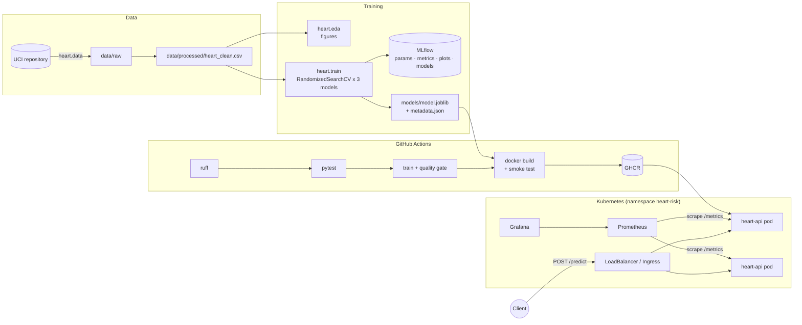

# Heart Disease Risk: End-to-End MLOps Pipeline

Predicts the presence of heart disease from 13 clinical attributes (UCI Heart Disease dataset) and serves the model as a monitored, containerised API on Kubernetes.

> **Disclaimer:** an academic MLOps exercise. Predictions, risk bands and thresholds are modelling choices, not medical advice or diagnostic rules.

> **Repository:** `<add your GitHub URL>` · **Course:** MLOps AIMLCZG523, Assignment 01

## Architecture



## Repository layout

```
src/heart/          python package: config, data, features, models, train, evaluate, eda, predict
api/                FastAPI app (main.py) and pydantic schemas
tests/              pytest suite (data, features, model, API, end-to-end training)
notebooks/          01_eda, 02_training, 03_inference
data/processed/     cleaned dataset (committed); data/raw is re-downloadable
k8s/                Deployment, Service (LoadBalancer), Ingress, HPA, monitoring/
monitoring/         Prometheus config + Grafana provisioning and dashboard
.github/workflows/  CI/CD pipeline
scripts/            smoke_test.sh, k8s_deploy.sh
screenshots/        evidence for the report
```

## 1. Setup (clean environment)

Requires Python 3.11, Docker, and optionally Minikube or Docker Desktop Kubernetes.

```bash
python3.11 -m venv .venv && source .venv/bin/activate
pip install -r requirements-dev.txt      # includes requirements.txt and `pip install -e .`
```

## 2. Data and EDA

```bash
python -m heart.data                     # Cleveland subset (default)
# python -m heart.data --sites cleveland hungarian switzerland va   # all four sites
python -m heart.eda                      # -> reports/figures/eda/*.png
```

Cleaning keeps missing values as NaN; imputation happens inside the model pipeline so validation folds never influence it. The target `num` (0–4) is binarised to `target = num > 0`. A schema validation step (`heart.data.validate`) checks required columns, row count, a binary target with both classes, plausible value ranges and category codes. It runs after cleaning and again before training, so a corrupted CSV stops the pipeline with a clear message.

## 3. Training and experiment tracking

```bash
python -m heart.train --n-iter 30                      # 3 models x 3 feature sets
python -m heart.train --feature-sets ratio --n-iter 10  # quicker, single feature set
mlflow ui --backend-store-uri ./mlruns                 # http://localhost:5000
```

**Feature-set ablation.** Every model family is trained on three feature sets:

| Feature set | Adds to the 13 raw attributes |
|---|---|
| `raw` | nothing |
| `ratio` | `hr_reserve_ratio` = thalach / (220 − age) |
| `clinical` | ratio + age band (<45/45–54/55–64/65+), cholesterol band (NCEP ATP III: <200/200–239/240+), systolic BP band (ACC/AHA 2017: <120/120–129/130–139/140+) |

**What is logged.** Each (model, feature set) pair is an MLflow parent run tagged with `model_family` and `feature_set`, with a nested child run per hyper-parameter candidate. Parent runs log:
- the preprocessing, CV and seed settings as params,
- 5-fold CV mean/std for accuracy, precision, recall, F1 and ROC-AUC,
- out-of-fold Brier score and recall/precision/AUC for women and men separately,
- single-request inference latency and test-set metrics,
- plots: confusion matrix, ROC, PR, permutation importance, calibration curve and subgroup chart,
- the fitted pipeline with its signature.

The selected run also gets cross-run comparison artefacts (`feature_set_ablation.png`, `model_comparison.png`, `calibration_comparison.png`, `model_comparison.csv`).

**Decisions made without the test set.** The decision threshold maximises F2 (recall weighted ×2) on out-of-fold training predictions, because a missed case costs more than a false alarm in screening. Calibration and subgroup checks also use those out-of-fold predictions; the test split is only used for final reporting.

**Model selection (parsimony rule).** Among runs within 0.005 CV ROC-AUC of the best (well inside fold noise at this sample size), the more interpretable model family wins (LR > RF > boosting), then the simpler feature set. Extra complexity has to earn its place. The rule is configurable with `--tolerance`, and the selected run, feature set and rule are recorded in `models/metadata.json`.

## 4. Tests and lint

```bash
ruff check .
pytest --cov=heart --cov=api
```

## 5. Serve locally

```bash
uvicorn api.main:app --port 8000          # docs at http://localhost:8000/docs
curl -X POST localhost:8000/predict -H "Content-Type: application/json" -d @sample_request.json
```

Example response:

```json
{"prediction": 1, "label": "heart_disease", "probability_disease": 0.87,
 "confidence": 0.87, "api_version": "v1", "model_version": "20261011...",
 "decision_threshold": 0.38, "request_id": "a1b2c3d4e5f60718"}
```

Responses carry `api_version` (also as the `X-API-Version` header) so the contract can evolve without breaking clients. A client-supplied `X-Request-ID` is echoed back for tracing, and invalid input returns 422 naming the offending field.

| Endpoint | Purpose |
|---|---|
| `POST /predict` | one patient → prediction + confidence |
| `POST /predict/batch` | up to 100 patients |
| `GET /health` | 200 when model loaded, 503 otherwise (used by K8s probes) |
| `GET /model-info` | model name, version, metrics, threshold |
| `GET /metrics` | Prometheus metrics |

## 6. Docker

```bash
docker build -t heart-risk-api:latest .   # needs models/model.joblib from step 3
docker run --rm -p 8000:8000 heart-risk-api:latest
bash scripts/smoke_test.sh http://localhost:8000
```

## 7. Kubernetes (Minikube)

```bash
minikube start --cpus 2 --memory 4096
minikube addons enable metrics-server     # for the HPA
bash scripts/k8s_deploy.sh                # loads image, applies manifests + monitoring
minikube tunnel                           # separate terminal: gives the LoadBalancer an IP
kubectl -n heart-risk get svc heart-api   # use EXTERNAL-IP
bash scripts/smoke_test.sh http://<EXTERNAL-IP>
```

Non-secret settings (log level, model paths) live in `k8s/configmap.yaml` and are injected via `envFrom`.

Ingress alternative: `minikube addons enable ingress && kubectl apply -f k8s/ingress.yaml`, then map `heart-risk.local` to `minikube ip` in `/etc/hosts`.

## 8. Monitoring

Locally: `docker compose up --build -d` → Grafana at http://localhost:3000 (admin/admin), dashboard "Heart Risk API". On Minikube: `minikube service -n heart-risk grafana`.

The API emits one JSON log line per request and per prediction (request id, path, status, latency, predicted label/probability; never the patient's clinical values) and exposes request count, latency histogram, predictions by label and the predicted-probability distribution. The "share of positive predictions" panel is a simple drift signal.

Generate traffic for screenshots:

```bash
for i in $(seq 1 200); do curl -s -X POST localhost:8000/predict \
  -H "Content-Type: application/json" -d @sample_request.json >/dev/null; done
```

## 9. CI/CD

`.github/workflows/ci.yml` runs on every push and PR: **lint → test → train → docker**. Tests upload JUnit and coverage reports; training uploads the model, plots, `mlruns/` and logs as artefacts and writes a metrics table to the job summary. A quality gate fails the run if the selected model's CV ROC-AUC is below 0.80, and data validation fails it on a malformed dataset. The docker job builds the image, runs it, smoke-tests it and on `main` pushes it to GHCR.

## 10. Video walkthrough (suggested order)

1. Repository layout and the architecture diagram above.
2. `make data eda`, then two or three EDA figures.
3. `make train`, then the MLflow UI: filter by `tags.feature_set`, open the selected run's ablation and calibration plots.
4. `make lint test`, then the GitHub Actions run: a green pipeline plus one deliberately failing run.
5. `docker build` / `docker run`, then `scripts/smoke_test.sh`.
6. `scripts/k8s_deploy.sh`, `kubectl get pods,svc`, and a `/predict` call through the LoadBalancer.
7. Generate traffic, then show `kubectl logs` (JSON lines), Prometheus targets, and the Grafana dashboard.
8. Close with the report and reproducibility commands.
